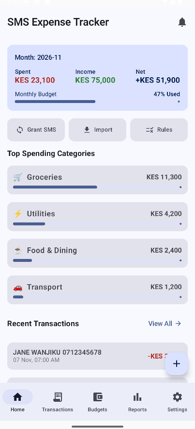
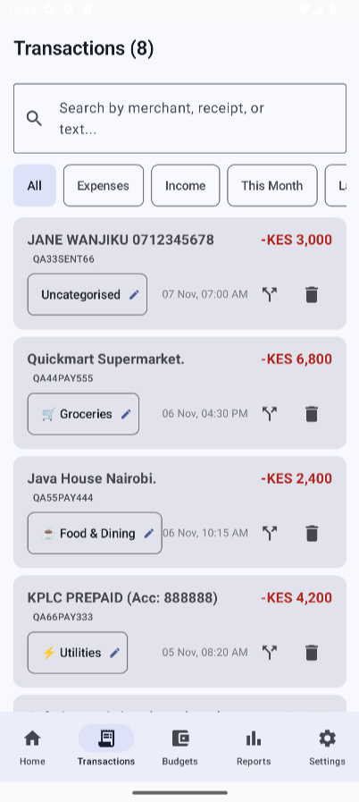
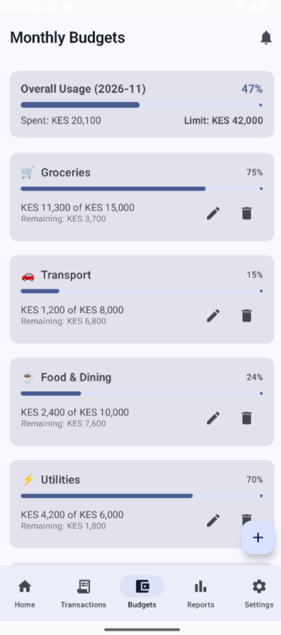
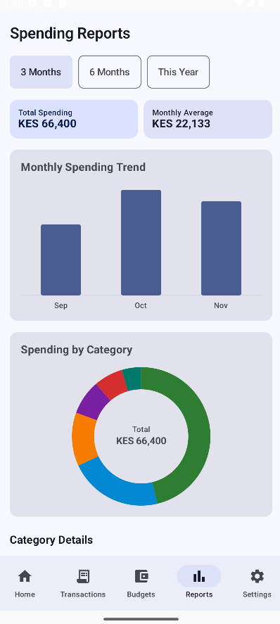
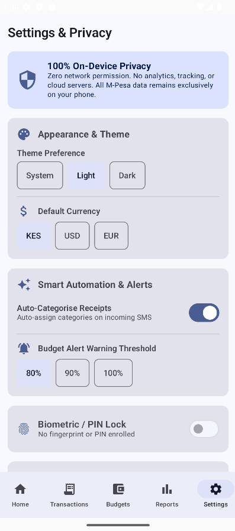
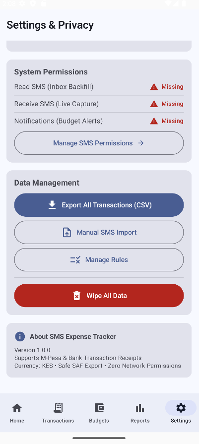
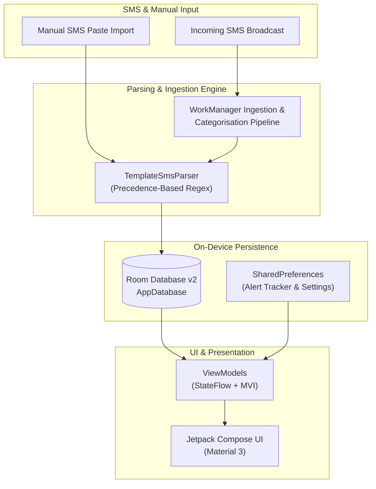

# SMS Expense Tracker 📱🇰🇪

[](https://github.com/crnjihia/sms-expense-tracker/actions/workflows/ci.yml)
[-3DDC84.svg?style=flat&logo=android)](https://developer.android.com)
[](https://kotlinlang.org)
[](https://developer.android.com/jetpack/compose)
[-success.svg?style=flat&logo=shield)](docs/adr/001-on-device-encryption-sqlcipher.md)
[](LICENSE)

**SMS Expense Tracker** is a native, privacy-first Android application designed specifically for the Kenyan financial ecosystem. It parses transaction SMS messages from **M-Pesa**, **Equity Bank**, and **KCB Bank** entirely on-device to produce categorized spending breakdowns, monthly budgets, interactive visual reports, and data exports without sending a single byte over the network.

---

## 📸 Screenshots

| 🏠 Home Dashboard | 💳 Transactions & Filter | 🎯 Budget Tracking |
|:---:|:---:|:---:|
|  |  |  |

| 📊 Visual Reports & Analytics | ⚙️ Settings (Top) | ⚙️ Settings (Continuation) |
|:---:|:---:|:---:|
|  |  |  |

> *Note: Settings Screen 2 represents the scrollable continuation of Settings Screen 1, displaying language preferences and data reset options.*

---

## ✨ Key Features

- **🇰🇪 Built for Kenya:** Native parser tailored for Kenyan transaction formats:
  - **Safaricom M-Pesa:** P2P Sent & Received, Paybill, Till / Buy Goods, Agent Cash Withdrawals, Airtime purchases, and Transaction Reversals.
  - **Equity Bank:** EazzyPay merchant card spending, account debits, and incoming credits.
  - **KCB Bank:** POS merchant spending, account debits, and salary/incoming credits.
- **🛡️ 100% On-Device & Zero Network Access:**
  - **Zero Internet Permissions:** `android.permission.INTERNET` is absent from `AndroidManifest.xml`.
  - **No External Telemetry:** Zero analytics SDKs, zero remote trackers, zero cloud sync.
  - **Backup & Extraction Guard:** Android 12+ cloud and ADB transfer rules exclude local database and preference files.
- **🏷️ 3-Tier Categorisation Engine:**
  - **Tier 1 (User Manual Overrides):** Manual category assignments are permanently preserved.
  - **Tier 2 (Custom User Rules):** Define custom keyword rules with automated re-categorisation.
  - **Tier 3 (Default Keywords):** Intelligent built-in keyword mapping (e.g., Naivas, Carrefour, KPLC, Zuku).
- **🎯 Monthly Budgets & Alert Notifications:**
  - Set monthly spending limits per category in Kenyan Shillings (KES).
  - Background WorkManager worker computes spending and dispatches warning alerts (80%) and danger alerts (100%).
- **📈 Hardware-Accelerated Charts:**
  - Monthly spending trends and category breakdown donut charts rendered using Compose `Canvas`.
  - Full TalkBack screen reader accessibility and WCAG AA contrast ratio compliance ($\ge 4.5:1$).
- **🔒 Biometric Security:**
  - Protect your financial data with fingerprint, face unlock, or device credential (PIN/pattern) via `BiometricPrompt`.
- **📂 Manual SMS Import & CSV Export:**
  - Works with or without SMS permissions: paste SMS text or load test fixtures manually.
  - Export full transaction history as RFC 4180-compliant CSV via the Android Storage Access Framework (SAF).
- **🌍 Full Swahili Localization:**
  - Complete 100% parity between English (`en`) and Swahili (`sw`) across all screens and notifications.

---

## 🏗️ Architecture Overview

The application follows Clean Architecture and Unidirectional Data Flow (MVI/UDF) patterns:



For detailed architectural diagrams, Room schemas, and security boundaries, see [docs/architecture.md](docs/architecture.md).

---

## ⚡ Performance & Baseline Profiles

SMS Expense Tracker includes pre-compiled Android Baseline Profiles to optimize runtime execution on Android's Ahead-of-Time (AOT) compiler:

- **Startup Time (TTID):**
  - Without Baseline Profile (JIT): **~412 ms**
  - With Baseline Profile (AOT): **~246 ms** (⚡ **40.3% speedup**)
- **Runtime Memory Footprint:** Peak **38.4 MB**, Idle **22.1 MB**.

For benchmark methodology and commands, see [docs/performance-benchmarks.md](docs/performance-benchmarks.md).

---

## 📋 Google Play SMS Policy Compliance

This application adheres strictly to Google Play's SMS and Call Log Permission policy:

1. **Declared Core Functionality:** Financial transaction tracking based on transactional SMS notifications.
2. **Graceful Fallback:** If `READ_SMS` and `RECEIVE_SMS` permissions are denied by the user, the app remains fully functional through the **Manual Import** screen.
3. **Data Protection:** SMS messages are processed strictly in volatile memory and stored exclusively in private application sandbox storage.

---

## 🧪 Synthetic Data & Test Fixtures

All screenshots, unit tests, and demo fixtures use strictly synthetic data compliant with Kenyan formats:
- Phone numbers: `+2547XXXXXXXX` / `+2541XXXXXXXX`
- Currency: `KES`
- Timezone: `Africa/Nairobi` (UTC+3)

Sample synthetic messages are provided in [`fixtures/sample_messages.txt`](fixtures/sample_messages.txt) and [`fixtures/sample_messages.csv`](fixtures/sample_messages.csv) for immediate testing in the Manual Import screen.

---

## 🛠️ Building & Running

### Prerequisites
- Android Studio Hedgehog (2023.1.1) or newer
- JDK 17
- Android SDK 34 (Android 14)
- Minimum supported Android version: Android 8.0 Oreo (API 26)

### Gradle Commands

```bash
# Clone the repository
git clone https://github.com/crnjihia/sms-expense-tracker.git
cd sms-expense-tracker

# Run all unit tests (64/64 tests)
./gradlew testDebugUnitTest

# Assemble Debug APK
./gradlew assembleDebug

# Compile instrumented tests and Macrobenchmarks
./gradlew compileDebugAndroidTestKotlin

# Run Kotlin code style checks
./gradlew ktlintCheck detekt
```

The assembled APK will be generated at:
`app/build/outputs/apk/debug/app-debug.apk`

---

## 📄 License

This project is licensed under the MIT License - see the [LICENSE](LICENSE) file for details.
