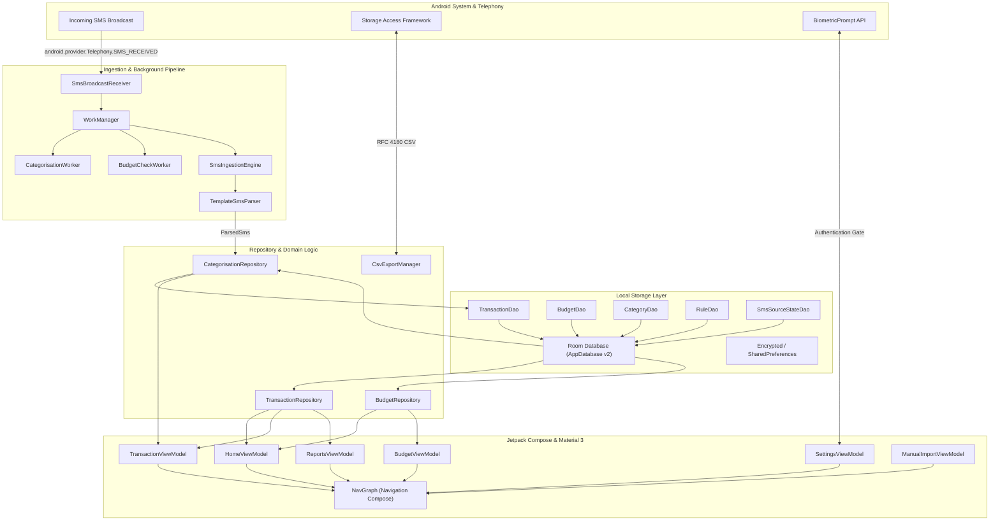
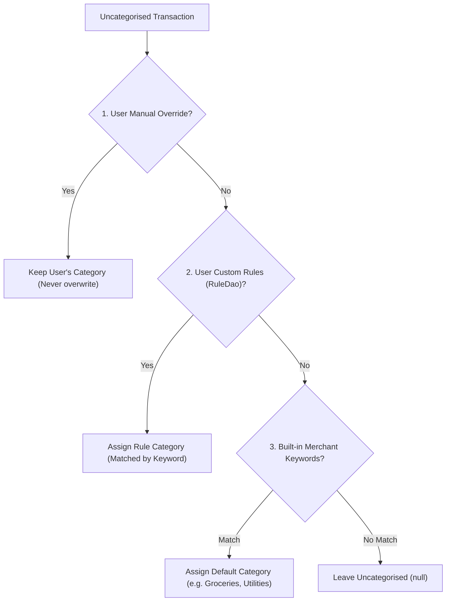

# Architecture & System Design

SMS Expense Tracker is built following modern Android Clean Architecture and Unidirectional Data Flow (MVI/UDF) principles with strict on-device data sovereignty (zero network permissions).

---

## High-Level Architecture Diagram

---

## 1. Zero Network & Privacy Boundary

The application deliberately excludes `android.permission.INTERNET` from `AndroidManifest.xml`.
- **Zero External Telemetry:** No Firebase, Google Analytics, Sentry, or third-party ad networks.
- **On-Device Parsing:** All SMS parsing and categorisation happen completely on the device's CPU.
- **Backup Exclusion:** `backup_rules.xml` and `data_extraction_rules.xml` explicitly exclude databases, shared preferences, and cache directories from cloud and device-to-device adb transfers.
- **Biometric Security:** Biometric authentication gates app access on cold-start and resume when enabled.

---

## 2. Parsing Pipeline (`TemplateSmsParser`)

The parsing engine applies a precedence-ordered set of regex templates against incoming SMS sender headers and normalized body text.

### Supported Senders & Formats:
1. **M-Pesa (`MPESA`, `M-PESA`):**
   - Person-to-Person (P2P) transfers (Sent & Received)
   - Paybill transactions (e.g., KPLC, Nairobi Water)
   - Buy Goods / Till transactions (e.g., Naivas, Carrefour)
   - Cash withdrawals via M-Pesa agents
   - Airtime purchases
   - Transaction reversals
2. **Equity Bank (`EQUITY`, `EQUITYBANK`, `EQUITYBC`):**
   - EazzyPay merchant card debits
   - Account debits with balance tracking
   - Account credits with reference codes
3. **KCB Bank (`KCB`, `KCBBANK`, `KCBGroup`):**
   - Point-of-Sale (POS) merchant spending
   - Account debits and credits

---

## 3. Categorisation Engine Precedence

When transactions are imported or backfilled, category assignment follows a strict 3-tier precedence hierarchy:

---

## 4. Room Database Schema (Version 2)

- **`transactions` table:**
  - `id`: Primary key (autoincrement)
  - `amount`: KES integer in whole shillings (negative for debits, positive for credits)
  - `timestamp`: UTC ISO-8601 `OffsetDateTime`
  - `description`: Clean counterparty or merchant name
  - `raw_sms_body`: Original text for debugging / auditing
  - `sender`: Sender identifier (e.g. `MPESA`)
  - `category_id`: Foreign key referencing `categories.id` (`ON DELETE SET NULL`)
  - `source_state_id`: Foreign key referencing `sms_source_states.id` (`ON DELETE CASCADE`)
- **`budgets` table:**
  - `id`: Primary key
  - `category_id`: Foreign key referencing `categories.id` (`ON DELETE CASCADE`)
  - `month`: String in format `YYYY-MM` (e.g. `2024-08`)
  - `limit_ksh`: Target budget threshold in KES
- **`categories` table:**
  - `id`: Primary key
  - `name`: Unique category name
  - `icon`: Icon identifier or emoji
  - `is_default`: Boolean
- **`categorisation_rules` table:**
  - `id`: Primary key
  - `category_id`: Foreign key referencing `categories.id` (`ON DELETE CASCADE`)
  - `keyword`: Normalized lowercase keyword to match against transaction descriptions

---

## 5. UI Architecture & Design System

- **Framework:** Jetpack Compose + Material 3 Design System.
- **State Management:** Unidirectional Data Flow via Kotlin `StateFlow` and Compose `collectAsStateWithLifecycle()`.
- **Navigation:** Single-Activity Compose navigation with typed destination routes:
  - `Screen.Home`
  - `Screen.Transactions`
  - `Screen.Budgets`
  - `Screen.Reports`
  - `Screen.Settings`
  - `Screen.ManualImport`
  - `Screen.RuleList` & `Screen.RuleEdit`
  - `Screen.BudgetEdit`
- **Charts:** Bespoke hardware-accelerated Compose `Canvas` implementations (monthly trend bar chart and category breakdown donut chart) with TalkBack accessibility labels and contrast guarantees ($\ge 4.5:1$).

